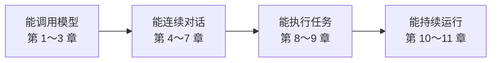

这组文章参考 pi 的真实实现，从一个可以运行的模型调用开始，每章只增加一项可以观察的能力，逐步构建一个能连续对话、执行工具、恢复会话和压缩历史的 Agent。

涉及的两个核心包是：

- `@earendil-works/pi-ai`：连接模型并统一消息和事件；
- `@earendil-works/pi-agent-core`：推进对话、执行工具和维护状态。

## 整个系列会得到什么

这条路线围绕四个逐步出现的问题展开：怎样得到模型回复？怎样利用前一轮内容继续对话？怎样让程序执行模型提出的操作？会话中断或历史过长时，怎样继续？

## 第一阶段：能调用模型

| 章 | 本章只解决什么 | 学完可以做什么 |
|---|---|---|
| [1. 定义一次模型调用](../01-unified-contract/) | 固定一次调用的输入和输出 | 指定模型和对话内容，取得完整回复 |
| [2. 选择并调用不同模型服务](../02-provider-routing/) | 隔离服务选择和认证差异 | 使用同一个入口切换模型服务 |
| [3. 接入阿里云百炼](../03-bailian-provider/) | 用现有协议适配器组装百炼 Provider | 完成一次真实百炼模型请求 |

读完这一阶段，你可以使用统一的调用入口选择模型服务，并完成一次真实的百炼模型请求。

## 第二阶段：能连续对话

| 章 | 本章只解决什么 | 学完可以做什么 |
|---|---|---|
| [4. 让模型回复逐字显示](../04-streaming-text/) | 把文本分片立即交给显示端 | 第一段文字到达时就开始显示回复 |
| [5. 让事件流同时提供过程和结果](../05-events-and-result/) | 同时提供回复过程和最终消息 | 显示端读取分片，调用方取得完整回复 |
| [6. 让 Agent 完成一次问答](../06-agent-question-answer/) | 将一次问答交给 Agent，并接收回复事件 | 用 Agent 完成一次流式问答 |
| [7. 保存消息并连续对话](../07-conversation-history/) | 把上一轮消息加入下一次请求 | 让 Agent 根据前几轮内容继续回答 |

读完这一阶段，Agent 已经可以流式显示并进行多轮对话。

## 第三阶段：能执行任务

| 章 | 本章只解决什么 | 学完可以做什么 |
|---|---|---|
| [8. 让 Agent 调用工具](../08-tool-calling/) | 执行模型提出的工具请求，并交回结果 | 让 Agent 调用工具，再根据结果继续回答 |
| [9. 工具如何完成实际操作](../09-tool-implementation/) | 理解工具如何执行操作并组织结果 | 沿用原生工具的结构实现同类操作 |

读完这一阶段，Agent 能调用工具推进任务，读者也能理解并实现工具内部的具体操作。

## 第四阶段：能持续运行

| 章 | 本章只解决什么 | 学完可以做什么 |
|---|---|---|
| [10. 保存并恢复会话](../10-session-persistence/) | 将会话消息保存到磁盘并重新加载 | 进程重启后，基于已保存的消息继续对话 |
| [11. 压缩过长的上下文](../11-context-compaction/) | 将较早的历史整理为摘要，缩短后续请求 | 保留继续任务所需的关键信息，为新消息腾出空间 |

读完这一阶段，你可以恢复已保存的会话，并在历史过长时用摘要缩短上下文，让 Agent 基于保留的信息继续处理任务。

## 每章如何组织

每章遵循同一顺序：

1. 从一个可以观察的问题开始，说明完成本章后会有什么变化；
2. 用一张简单总览图说明输入经过什么、最终得到什么；
3. 沿主调用链逐个回答读者的问题，在需要时引入概念和代码；
4. 运行一个最小 Lab，通过输入、输出和必要的中间数据观察结果；
5. 总结新增的能力，并提供源码核对入口。

示例用于说明可以迁移到其他场景的实现方法；只有帮助回答当前问题的细节才进入正文。完整可运行示例放在 `labs/`，正文保留解释机制所需的核心代码。

## 当前进度

- 已完成：[第 1 章](../01-unified-contract/)、[第 2 章](../02-provider-routing/)、[第 3 章](../03-bailian-provider/)、[第 4 章](../04-streaming-text/)、[第 5 章](../05-events-and-result/)、[第 6 章](../06-agent-question-answer/)、[第 7 章](../07-conversation-history/)、[第 8 章](../08-tool-calling/)、[第 9 章](../09-tool-implementation/)、[第 10 章](../10-session-persistence/)、[第 11 章](../11-context-compaction/)

当前可按 1 → 2 → 3 → 4 → 5 → 6 → 7 → 8 → 9 → 10 → 11 阅读。
