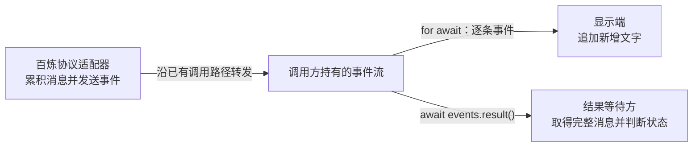

上一章已经能逐段显示回复。现在，如果上层还需要取得完整消息，就要在事件循环中接住最终结果。本章让显示端继续读取分片，上层通过同一个事件流的 `result()` 等待完整消息。



图中的百炼配置、文本累积和转发路径沿用前文。本章只增加完整消息的读取方式。

## 1. 一次请求为什么需要两种读取方式

显示端关心“现在多了哪些文字”，后续处理关心“这次调用最终得到了什么”。前者需要逐条事件，后者需要一条 `AssistantMessage`，其中既有内容，也有结束原因。

事件迭代沿用第四章。理解新增的结果读取方式，只需要区分以下三项：

| 概念 | 解决什么问题 |
|---|---|
| 结果 Promise | 表示尚未取得或已经取得的最终消息；调用方通过 `await` 等待它 |
| 终态事件 | `done` 或 `error`，携带本次调用最终得到的消息 |
| 事件队列 `queue` | 暂存尚未读取的事件，供显示端按序取出 |

## 2. 在显示分片的同时保留最终结果

从第四章的调用方继续，只需保留 `models.stream()` 返回的对象，再调用它的 `result()`。下面是调用端片段，`models`、`model`、`context` 沿用上一章：

```ts
const events = models.stream(model, context, { maxTokens: 256 });
const replyPromise = events.result();

for await (const event of events) {
	if (event.type === "text_delta") {
		process.stdout.write(event.delta);
	}
}

const reply = await replyPromise;
if (reply.stopReason === "error" || reply.stopReason === "aborted") {
	throw new Error(reply.errorMessage ?? reply.stopReason);
}
console.log("\n完整消息：", reply.content);
```

这三种写法分别表示方法、等待结果的 Promise 和完整消息：

| 写法 | 得到什么 |
|---|---|
| `events.result()` | 调用事件流的方法，立即返回一个 `Promise<AssistantMessage>` |
| `replyPromise` | 保存这个 Promise；模型还没结束时，它尚未得到最终消息 |
| `await replyPromise` | 等待 Promise 得到最终消息，并把消息赋给 `reply` |

`const replyPromise = events.result()` 没有等待 Promise，所以执行完这一行就会进入事件循环。分片仍然随到随显示；循环结束后，程序取得完整消息，并检查请求是否失败或被中止。

这里把 `await replyPromise` 写在循环之后，是为了先完成终端显示；其他需要完整消息的代码也可以同时等待这个 Promise。

整个片段只调用一次 `models.stream()`。`result()` 使用这次请求的结果；如果另外调用 `models.complete()`，就会发起另一轮模型调用。

## 3. 同一条流如何分别交付事件和结果

`models.stream()` 返回的 `events` 是 `AssistantMessageEventStream`，它通过[前文的转发路径](../02-provider-routing/#等待认证时先把事件流交给调用方)接收适配器事件。事件和最终消息的交付实现在 [`utils/event-stream.ts`](https://github.com/earendil-works/pi/blob/3fc3ef532b966b28b764af070d62302c0acab0d5/packages/ai/src/utils/event-stream.ts) 中。

这些能力由父类 `EventStream` 提供，子类 `AssistantMessageEventStream` 在构造时设置消息的完成规则。`result()`、`push()` 和事件迭代方法都操作同一个事件流对象上的字段。

### result() 返回创建事件流时准备好的 Promise

`AssistantMessageEventStream` 的父类 [`EventStream`](https://github.com/earendil-works/pi/blob/3fc3ef532b966b28b764af070d62302c0acab0d5/packages/ai/src/utils/event-stream.ts#L4-L66) 在构造时创建结果 Promise，`result()` 返回它。`T` 表示事件类型，`R` 表示最终结果类型：

```ts
export class EventStream<T, R = T> implements AsyncIterable<T> {
	private finalResultPromise: Promise<R>;
	private resolveFinalResult!: (result: R) => void;
	private isComplete: (event: T) => boolean;
	private extractResult: (event: T) => R;

	constructor(isComplete: (event: T) => boolean, extractResult: (event: T) => R) {
		this.isComplete = isComplete;
		this.extractResult = extractResult;
		this.finalResultPromise = new Promise((resolve) => {
			this.resolveFinalResult = resolve;
		});
	}

	result(): Promise<R> {
		return this.finalResultPromise;
	}

	// ...
}
```

构造函数在创建事件流对象时执行一次，把 Promise 保存到该对象的 `finalResultPromise` 字段；`result()` 读取的就是同一个对象上的这个字段。`resolveFinalResult` 保存了提供最终消息的函数，发送端以后调用它，Promise 就得到结果。第二节的 `replyPromise` 与这个字段指向同一个 Promise，反复调用 `result()` 不会再次调用模型。

### 终态事件先确定结果，再继续交付给读取方

第四章的适配器在结束时发送 `done` 或 `error`。例如，[成功收尾时的实际调用](https://github.com/earendil-works/pi/blob/3fc3ef532b966b28b764af070d62302c0acab0d5/packages/ai/src/api/openai-completions.ts#L690-L691)是：

```ts
stream.push({ type: "done", reason: output.stopReason, message: output });
stream.end();
```

这里的 `output` 已由适配器累积完成。要从事件中取出它，`AssistantMessageEventStream` 在构造时向父类传入两条规则。下面是[这个子类的完整定义](https://github.com/earendil-works/pi/blob/3fc3ef532b966b28b764af070d62302c0acab0d5/packages/ai/src/utils/event-stream.ts#L69-L83)：

```ts
export class AssistantMessageEventStream extends EventStream<AssistantMessageEvent, AssistantMessage> {
	constructor() {
		super(
			(event) => event.type === "done" || event.type === "error",
			(event) => {
				if (event.type === "done") {
					return event.message;
				} else if (event.type === "error") {
					return event.error;
				}
				throw new Error("Unexpected event type for final result");
			},
		);
	}
}
```

`extends` 指明它继承 `EventStream`，其中的事件类型是 `AssistantMessageEvent`，结果类型是 `AssistantMessage`。`super(...)` 调用上一小节的父类构造函数，把两条规则分别保存为 `isComplete` 和 `extractResult`，同时创建结果 Promise。

发送端调用的是继承自父类的 [`push()`](https://github.com/earendil-works/pi/blob/3fc3ef532b966b28b764af070d62302c0acab0d5/packages/ai/src/utils/event-stream.ts#L21-L36)。它先判断是否收到终态事件并确定结果，再交付当前事件：

```ts
export class EventStream<T, R = T> implements AsyncIterable<T> {
	private queue: T[] = [];
	private done = false;
	// ...

	push(event: T): void {
		if (this.done) return;

		if (this.isComplete(event)) {
			this.done = true;
			this.resolveFinalResult(this.extractResult(event));
		}

		const waiter = this.waiting.shift();
		if (waiter) {
			// 把当前事件直接交给正在等待的读取方
		} else {
			this.queue.push(event);
		}
	}

	// ...
}
```

普通分片不会确定结果。收到 `done` 时，这里把 `event.message` 交给结果 Promise；收到 `error` 时则交出 `event.error`。`this.done` 标记发送已经结束，但这个分支没有提前返回，当前终态事件仍会进入后面的交付步骤。

后半段从 `waiting` 中取出正在等待读取的回调，记为 `waiter`：有读取方就直接交付，没有就执行 `this.queue.push(event)`。因此，提供最终消息不会取走终态事件，它仍然可以像前面的分片一样被显示端读到。

### 事件迭代取走队列中的事件，不读取结果 Promise

`for await` 使用同一个 `EventStream` 的 [`[Symbol.asyncIterator]()` 方法](https://github.com/earendil-works/pi/blob/3fc3ef532b966b28b764af070d62302c0acab0d5/packages/ai/src/utils/event-stream.ts#L50-L62)读取事件。这个方法在循环中先检查队列，再判断事件流是否结束：

```ts
export class EventStream<T, R = T> implements AsyncIterable<T> {
	// ...

	async *[Symbol.asyncIterator](): AsyncIterator<T> {
		while (true) {
			if (this.queue.length > 0) {
				yield this.queue.shift()!;
			} else if (this.done) {
				return;
			} else {
				// 等待并交付下一条事件
			}
		}
	}
}
```

`queue.shift()` 取出最早的事件，`yield` 将它交给显示循环。队列为空且流已结束时，迭代才退出。这段读取操作不会访问 `finalResultPromise`，所以不会与结果等待方争抢数据。

用“你好”观察完整过程：假设适配器依次生成 `"你"`、`"好"`，显示端暂时还没有开始迭代。两个分片和终态事件到达后，队列与结果 Promise 的变化如下：

| 时刻 | 队列中尚未读取的事件 | `replyPromise` 的状态 |
|---|---|---|
| 写入 `"你"` 的分片后 | `"你"` 的分片 | 等待最终消息 |
| 写入 `"好"` 的分片后 | `"你"`、`"好"` 的分片 | 等待最终消息 |
| 写入 `done` 后 | 两个分片、`done` | 已得到文本为“你好”的完整消息 |
| 显示端开始迭代并读完后 | 空 | 仍可取得同一条完整消息 |

第三行中，`push()` 已经确定结果，显示端却还没读取任何事件。第四行中，迭代器先取完队列再退出。两种读取可以在不同时间完成，这正是同一条流能同时提供过程和结果的原因。

### 用 end() 完成事件流收尾

适配器先发送终态事件，再调用 [`end()`](https://github.com/earendil-works/pi/blob/3fc3ef532b966b28b764af070d62302c0acab0d5/packages/ai/src/utils/event-stream.ts#L38-L48) 收尾。它把 `this.done` 设为 `true`，停止接收新事件，并通知所有仍在等待事件的读取方退出；已经产生但尚未读取的事件仍能从队列中读出。

`end()` 有两种调用方式。传入最终消息 `message` 时：

```ts
stream.end(message); // 关闭事件流，并把 message 交给结果 Promise
```

不传入消息时：

```ts
stream.end(); // 关闭事件流，不额外提供最终消息
```

前一种调用为尚未确定的结果 Promise 提供 `message`，让 `await stream.result()` 取得它；已经确定的结果不会被覆盖。后一种调用不改变结果 Promise：如果此前没有提供过结果，事件迭代会结束，`await stream.result()` 却仍会等待。

`push(done)` 提供最终消息并交付终态事件，随后 `end()` 通知仍在等待的读取方结束；最终结果在前一步就已经确定。

## 4. 运行 Lab，核对显示文本和最终消息

完整程序在 `labs/05-events-and-result.ts`，代码分成两部分：

1. **真实百炼调用：先读取分片，再取得完整消息。** 验证回复能够持续显示，并且所有分片拼接后与最终消息的文本一致。
2. **固定事件验证：先取得完整消息，再读取事件。** 使用“你”“好”两个固定分片，验证不读取事件也能取得“你好”，而且取得结果后，分片和结束事件仍能完整读出。这部分不调用模型。

沿用第四章的依赖和 `.env` 配置，在项目根目录运行：

```bash
node labs/05-events-and-result.ts
```

输入仍然是：

```text
用中文分三句话解释为什么流式回复能减少等待感。
```

下面是一次成功运行的输出示例，实际文本和分片数量会随模型响应变化：

```text
input: 用中文分三句话解释为什么流式回复能减少等待感。
model: qwen3.8-flash
delta 1: "流"
delta 2: "式回复通过逐"
delta 3: "字或"
...
result text: "流式回复通过逐字或逐段即时输出内容，让用户在生成过程中就能看到部分结果。这种即时反馈打破了传统一次性返回时的空白等待期，有效缓解了用户的焦虑情绪。它利用人类对渐进式信息的自然接受习惯，显著降低了主观感知上的延迟时间。"
text_delta events: 18
stopReason: stop
real call text matches result
mechanism input: ["你","好"]
mechanism result before iteration: [{"type":"text","text":"你好"}]
mechanism events after result: ["你","好","done"]
chapter 5 events and result passed
```

最后出现 `chapter 5 events and result passed` 表示两部分验证均通过；请求失败或断言不满足时，程序会报错退出。

## 5. 两种读取方式需要遵守哪些边界

**取得结果后仍要判断是否成功。** `error` 事件同样会让结果 Promise 得到一条消息，不能只靠 `await` 是否抛错判断请求是否成功。第二节检查 `reply.stopReason`，遇到失败或中止时使用 `errorMessage` 报错。

**需要完整事件过程时，只用一个读取循环。** 多个 `for await` 会分摊同一条流的事件。第二节的 `await replyPromise` 只等待完整消息，不会与循环争抢事件。

## 6. 本章小结

现在，同一次百炼请求可以边返回边显示，并向等待完整消息的代码提供结果。事件由一处循环按序读取，最终消息在终态事件写入时确定；显示文本与最终消息可以相互核对，请求失败也能通过结果状态明确识别。

对应源码：

- [`utils/event-stream.ts`](https://github.com/earendil-works/pi/blob/3fc3ef532b966b28b764af070d62302c0acab0d5/packages/ai/src/utils/event-stream.ts)：`EventStream` 与 `AssistantMessageEventStream`，包含事件交付、结果 Promise、异步迭代和结束处理。
- [`models.ts`](https://github.com/earendil-works/pi/blob/3fc3ef532b966b28b764af070d62302c0acab0d5/packages/ai/src/models.ts)：`models.stream()` 返回事件流，`models.complete()` 通过 `result()` 等待完整消息。
- [`api/openai-completions.ts`](https://github.com/earendil-works/pi/blob/3fc3ef532b966b28b764af070d62302c0acab0d5/packages/ai/src/api/openai-completions.ts#L690-L714)：百炼使用的协议适配器，展示发送 `done` / `error` 后调用 `end()` 的实际位置。
