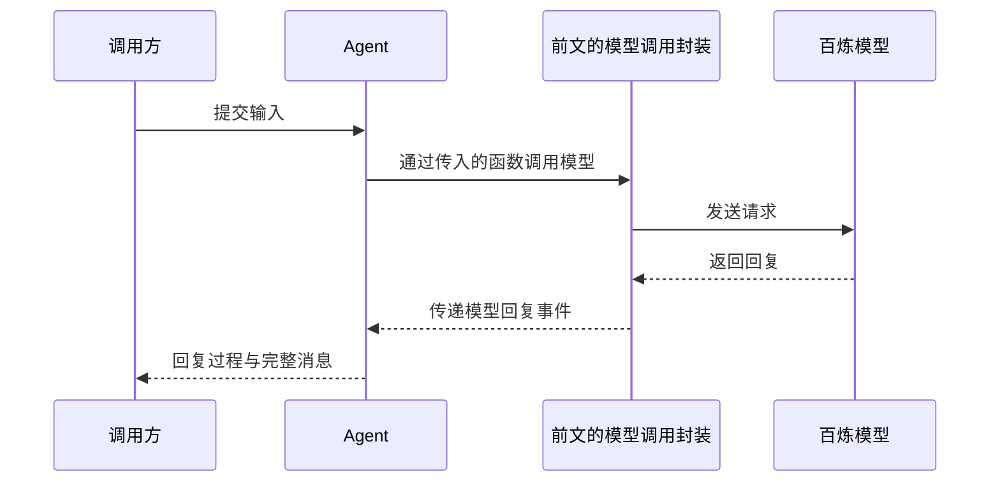

> 上一章：[让事件流同时提供过程和结果](../05-events-and-result/) · 下一章：[保存消息并连续对话](../07-conversation-history/) · 系列导读：[从一次模型调用到 Agent 内核](../00-overview/)

上一章的调用方直接组装 `Context`、读取模型事件流并等待完整结果。现在把一次问答交给 Agent：调用方提交一条输入，通过事件显示分片并取得完整回复，模型请求仍使用前文已经配置好的百炼调用。



Agent 位于调用方和模型调用封装之间。它负责组织这次处理，百炼配置、认证和协议适配仍由前文的模型调用封装完成。

## 1. 把一次问答交给谁处理

`@earendil-works/pi-agent-core` 提供的 `Agent` 是一个保存运行状态、接收输入并推进执行的对象。调用方与它通过三个入口配合：

| 入口 | 谁调用谁 | 本章中的作用 |
|---|---|---|
| `agent.prompt(input)` | 调用方 → Agent | 提交输入，等待这次处理结束 |
| 创建 Agent 时传入的 `streamFn` | Agent → 模型调用函数 | 用模型、上下文和选项发起请求，返回模型事件流 |
| `agent.subscribe(listener)` | 调用方 → Agent（注册） | 注册接收函数，Agent 随后调用 `listener` 通知回复事件 |

`streamFn` 决定请求怎样发出，`subscribe()` 决定调用方怎样接收过程。Agent 使用前者取得模型事件流，再把处理后的事件交给后者。

## 2. 用已有百炼配置完成一次流式问答

沿用第五章的 `models` 和 `model`，先注册接收事件的回调，再调用 `prompt()` 提交输入。完整百炼配置和可运行代码放在 Lab 中：

```ts
import { Agent } from "@earendil-works/pi-agent-core";
import type { AssistantMessage } from "@earendil-works/pi-ai";

const agent = new Agent({
	initialState: { model, systemPrompt: "严格按用户要求回答。", messages: [] },
	streamFn: (model, context, options) =>
		models.streamSimple(model, context, { ...options, maxTokens: 128 }),
});

let reply: AssistantMessage | undefined;
agent.subscribe((event) => {
	if (event.type === "message_update" && event.assistantMessageEvent.type === "text_delta") {
		process.stdout.write(event.assistantMessageEvent.delta);
	}
	if (event.type === "message_end" && event.message.role === "assistant") {
		reply = event.message;
	}
});

await agent.prompt("请只回复：你好，Agent。");
if (!reply) throw new Error("没有收到完整回复");
if (reply.stopReason === "error" || reply.stopReason === "aborted") {
	throw new Error(reply.errorMessage ?? reply.stopReason);
}
console.log("\n完整回复：", reply.content);
```

`initialState` 设置当前模型、系统提示词和空消息列表。`streamFn` 使用前文的 `models`，通过 `streamSimple()` 接受 Agent 提供的通用调用选项；返回的仍是第五章介绍的模型事件流。

显示回调处理两种 Agent 事件：

- `message_update` 携带正在变化的回复，其中 `assistantMessageEvent` 是原始模型事件。遇到 `text_delta`，继续追加新增文字。
- `message_end` 携带已经结束的消息。用户输入也会产生这个事件，所以取得模型回复时还要判断 `role === "assistant"`。

`await agent.prompt()` 等待这次处理及事件回调完成，返回值是 `void`。上面的 `reply` 来自结束事件；失败消息也能通过这个事件交付，因此仍要按第五章的方法检查 `stopReason`。

## 3. 从提交输入追踪到模型调用，再回到调用方

这次问答沿下面的真实调用链执行：

```text
Agent.prompt(input)
├─ normalizePromptInput(...) → 把文本整理为用户消息
└─ runPromptMessages(...)
   └─ runWithLifecycle(回调) → 执行回调并管理运行状态
      └─ runAgentLoop(...) → 准备本次上下文
         └─ runLoop(...) → 推进执行
            └─ streamAssistantResponse(...) → 调用模型并读取回复
               └─ streamFunction(...) → 我们传入的 models.streamSimple(...)
```

下面保留与这条路径有关的源码，省略无关字段和分支。

### prompt() 整理输入，并传入两个不同的回调

`Agent.prompt()` 先把输入变成消息，再开始执行：

```ts
const messages = this.normalizePromptInput(input, images);
await this.runPromptMessages(messages);
```

本例传入字符串。`normalizePromptInput()` 中的文本分支构造内容块，再返回一条用户消息：

```ts
const content: Array<TextContent | ImageContent> = [{ type: "text", text: input }];
// ...
return [{ role: "user", content, timestamp: Date.now() }];
```

接下来，`runPromptMessages()` 的方法体把执行参数交给 `runAgentLoop()`：

```ts
await this.runWithLifecycle(async (signal) => {
	await runAgentLoop(
		messages,
		this.createContextSnapshot(),
		this.createLoopConfig(options),
		(event) => this.processEvents(event),
		signal,
		this.streamFunction,
	);
});
```

`createContextSnapshot()` 提供当前系统提示词和消息列表的副本，本例起始消息列表为空；`createLoopConfig()` 提供当前模型和消息转换等调用配置。`runWithLifecycle()` 执行内部回调并管理运行状态，`signal` 是随调用传下去的中止信号。

这里最重要的是两个回调的方向：

| 传入的函数 | 内部参数名 | 用途 |
|---|---|---|
| `this.streamFunction` | `streamFn` | 发起模型请求 |
| `(event) => this.processEvents(event)` | `emit` | 把执行事件交回当前 Agent |

`this.streamFunction` 来自构造 Agent 时的赋值：

```ts
this.streamFunction = runtimeOptions.streamFn ?? getDefaultStreamFn();
```

`runtimeOptions` 来自创建 Agent 时传入的选项。本例明确提供了 `streamFn`，因此保存的就是第二节调用 `models.streamSimple()` 的函数。

### runLoop() 将请求交给前文的模型调用封装

`runAgentLoop()` 接收到的新用户消息参数名是 `prompts`。它先准备本次上下文，再调用 `runLoop()`，继续传递同一个 `emit` 和 `streamFn`：

```ts
const newMessages: AgentMessage[] = [...prompts];
const currentContext: AgentContext = {
	...context,
	messages: [...context.messages, ...prompts],
};
// ...
await runLoop(currentContext, newMessages, config, signal, emit, streamFn ?? getDefaultStreamFn());
```

本例开始时 `context.messages` 为空，所以 `currentContext.messages` 只包含刚构造的那条用户消息。`newMessages` 收集本次产生的消息。`runLoop()` 接收模型调用函数时，参数名是 `streamFunction`；它再调用 `streamAssistantResponse()`：

```ts
// runLoop() 内部
let currentContext = initialContext;
let config = initialConfig;
// ...
const message = await streamAssistantResponse(currentContext, config, signal, emit, streamFunction);
newMessages.push(message);
```

`streamAssistantResponse()` 把消息整理成前文的 `Context`，然后调用这个函数。以下保留请求消息的组装和实际调用位置：

```ts
let messages = context.messages;
// ...
const llmMessages = await config.convertToLlm(messages);
const llmContext: Context = {
	systemPrompt: context.systemPrompt,
	messages: llmMessages,
	// ...
};

// ...
const response = await streamFunction(config.model, llmContext, {
	...config,
	// ...
});
```

`config.convertToLlm` 选出模型能接受的消息。本例使用默认转换，唯一一条用户消息会被保留。因此，`streamFunction(...)` 实际进入我们传入的回调，以这一条消息调用 `models.streamSimple()`。

`models.streamSimple()` 接受 Agent 的通用选项，复用第二、三章已经介绍的 Provider 选择、认证与百炼适配，返回模型事件流。Agent 与前文封装的衔接到这里就完成了。

### 模型事件如何变成调用方收到的 Agent 事件

`streamAssistantResponse()` 得到 `response` 后，在函数内部执行 `for await (const event of response)`。收到模型开始事件时建立临时回复；收到内容事件时，把原始事件放进 Agent 的 `message_update`。内容更新分支中的实际发送位置是：

```ts
partialMessage = event.partial;
// ...
await emit({
	type: "message_update",
	assistantMessageEvent: event,
	message: { ...partialMessage },
});
```

收到模型的 `done` 或 `error` 后，该函数调用第五章的 `result()` 取得完整消息，再发送 `message_end`。下面省略本次消息列表的更新：

```ts
const finalMessage = await response.result();
// ...
await emit({ type: "message_end", message: finalMessage });
return finalMessage;
```

这两处 `emit()` 调用的都是最初传入的 `(event) => this.processEvents(event)`。所以事件沿下面的方向回到调用方：

```text
streamAssistantResponse() 调用 emit(event)
→ Agent.processEvents(event) 更新状态
→ 调用 subscribe() 注册的 listener(event, signal)
```

`listener` 是调用方传给 `subscribe()` 的事件处理函数，第二节的显示回调就是其中一个。`subscribe()` 只把它存入 `listeners`，注册时并不执行：

```ts
subscribe(listener: (event: AgentEvent, signal: AbortSignal) => Promise<void> | void): () => void {
	this.listeners.add(listener);
	return () => this.listeners.delete(listener);
}
```

真正调用 `listener` 的位置在 `processEvents()` 中。每次 `emit(event)` 把事件交给它后，它先更新 Agent 状态，再遍历 `listeners`，将同一个事件传给每个回调，并等待该回调执行完成：

```ts
// 状态更新后，通知调用方
for (const listener of this.listeners) {
	await listener(event, signal);
}
```

这样，第二节的显示回调就会随着事件到达而执行：收到 `message_update` 时，检查 `assistantMessageEvent` 是否为 `text_delta` 并显示分片；收到助手消息的 `message_end` 时，从 `message` 取得完整回复并赋给 `reply`。这些字段正是前面的 `streamAssistantResponse()` 构造事件时放入的内容。

本例只请求一条文本回复。处理完成后，内部执行结束，外层 `prompt()` 的等待也随之结束；此时结束事件的回调已经把完整回复赋给 `reply`。

## 4. 运行 Lab，核对一次请求的过程和结果

完整程序在 labs/06-agent-question-answer.ts。沿用第三章的 `.env` 配置，在项目根目录运行：

```bash
npm install
node labs/06-agent-question-answer.ts
```

依赖中新增了 `@earendil-works/pi-agent-core`。Lab 使用真实 `Agent` 和百炼服务，输入是：

```text
请只回复：你好，Agent。
```

运行时先看到逐步出现的 `stream reply`，随后看到结束事件交付的完整回复：

```text
input: 请只回复：你好，Agent。
stream reply: 你好，Agent。
complete reply: 你好，Agent。
```

对照输入、流式显示和完整回复，可以观察 `prompt()` 如何通过 Agent 事件把模型回答交给调用方。请求失败或中止时，程序会显示错误。

## 5. 本章小结

现在，调用方可以把一条输入交给 Agent。Agent 整理请求，通过传入的函数复用百炼调用，再把模型事件转为回复事件；调用方能够显示分片，并在这次处理结束时取得完整回复。

源码核对入口：[`agent.ts`](https://github.com/earendil-works/pi/blob/3fc3ef532b966b28b764af070d62302c0acab0d5/packages/agent/src/agent.ts) 包含输入入口、模型调用函数的接入和事件通知；[`agent-loop.ts`](https://github.com/earendil-works/pi/blob/3fc3ef532b966b28b764af070d62302c0acab0d5/packages/agent/src/agent-loop.ts) 包含执行推进和模型回复处理；[`models.ts`](https://github.com/earendil-works/pi/blob/3fc3ef532b966b28b764af070d62302c0acab0d5/packages/ai/src/models.ts) 包含复用 Provider 与认证的调用入口。
