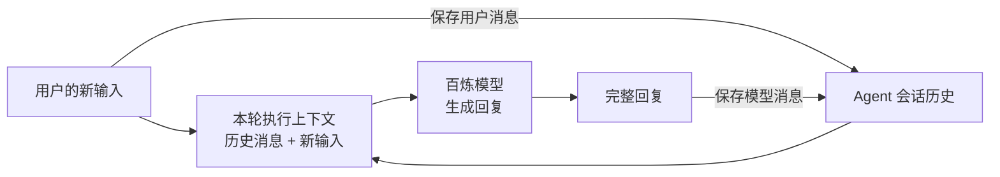

> 上一章：[让 Agent 完成一次问答](../06-agent-question-answer/) · 下一章：[让 Agent 调用工具](../08-tool-calling/) · 系列导读：[从一次模型调用到 Agent 内核](../00-overview/)

上一章已经用 Agent 完成一次流式问答。现在继续向同一个 Agent 提交第二条输入，让模型依据第一轮内容回答新问题。本章解释第一轮消息怎样保存、怎样进入第二次请求，以及新回复怎样再次留下来。



Agent 在请求模型前保存用户消息，在回复结束后保存模型消息。本轮保存的消息，在下一次输入到来时重新成为请求的一部分。

## 1. 第二次请求为什么需要第一轮消息

第一轮用户说“代号是松风”，模型回答“松风”。第二轮只问“刚才的代号是什么”，这次请求应包含：

```text
U1（user）:      代号是松风。
A1（assistant）: 松风。
U2（user）:      刚才的代号是什么？
```

下面用 `U1`、`U2` 表示两条用户消息，`A1`、`A2` 表示对应的完整回复。第二次请求需要 `[U1, A1, U2]`，模型根据这次收到的三条消息作答。“记住”来自再次发送历史。用户也可能追问“把你刚才的回答缩短”，所以历史需要同时保留用户输入和模型回复。

这里需要区分会话历史和本轮执行上下文：

| 数据 | 用途 |
|---|---|
| 会话历史 `agent.state.messages` | 留在同一个 Agent 中，按顺序保存已经结束的消息，供后续输入复用 |
| 本轮执行上下文 `AgentContext` | 携带本轮使用的系统提示词和消息列表；消息列表由历史与新输入合并而来，随后用于请求模型和处理回复 |

历史中的每一项仍是前文的消息对象，保留角色、内容块和结束原因等字段。终端上拼接出的文字用于显示，保存时使用完整消息。

## 2. 向同一个 Agent 连续提交两条输入

保留第六章的 Agent 创建方式和 `subscribe()` 回调。为了观察模型是否使用历史，把第一条问题换成一条代号信息，再增加第二次 `prompt()`：

```ts
await agent.prompt("请记住本次会话的代号是松风。只回复这个代号。");
console.log("第一轮后：", agent.state.messages.map((message) => message.role));

await agent.prompt("我刚才让你记住的代号是什么？只回复代号。");
console.log("第二轮后：", agent.state.messages.map((message) => message.role));
```

第一轮结束后，消息角色是 `["user", "assistant"]`；第二轮结束后变为 `["user", "assistant", "user", "assistant"]`。显示回调仍按上一章的方式接收分片和完整回复。

两次 `prompt()` 使用同一个 Agent，并按顺序等待。重新创建空 Agent 会失去前一轮历史；当前处理未结束时再次直接调用 `prompt()`，会被入口拒绝。

## 3. 消息如何保存，并进入下一次请求

第六章讲清了输入怎样到达模型、回复事件怎样回到 Agent。现在沿两轮问答检查消息的去向：先保存 `U1` 和 `A1`，再读取它们、合并 `U2` 并发出请求，最后保存 `A2`。

下面的源码节选保留实际调用位置和消息变化，省略无关字段与分支。

### 第一轮结束后，历史里为什么有两条消息

`prompt()` 按第六章的方式把字符串整理为用户消息，再通过 `runPromptMessages()` 进入 `runAgentLoop()`。第一轮的新输入参数 `prompts` 是 `[U1]`。在调用模型之前，`runAgentLoop()` 为新输入发送消息事件：

```ts
for (const prompt of prompts) {
	await emit({ type: "message_start", message: prompt });
	await emit({ type: "message_end", message: prompt });
}
```

用户输入已经完整，所以开始事件后紧接着就是结束事件。模型回复则由 `streamAssistantResponse()` 读取；收到终态事件后，它取得完整的 `A1`，再发送结束事件：

```ts
const finalMessage = await response.result();
// ...
await emit({ type: "message_end", message: finalMessage });
return finalMessage;
```

两处 `emit` 都是 `runPromptMessages()` 传入的 `(event) => this.processEvents(event)`。因此，`U1` 和 `A1` 都会进入当前 Agent 的同一个保存分支：

```ts
// Agent.processEvents() 的结束事件分支
case "message_end":
	this._state.streamingMessage = undefined;
	this._state.messages.push(event.message);
	break;
```

`this._state.messages` 就是调用方通过 `agent.state.messages` 读取的会话历史。初始历史为空，收到 `U1` 的结束事件后变为 `[U1]`，收到 `A1` 的结束事件后变为 `[U1, A1]`。保存发生在通知 `subscribe()` 回调之前，调用方无需再追加一次。

这里的 `streamingMessage` 只是 Agent 记录当前临时消息的字段。开始和分片更新事件会更新它，结束事件将它清空并保存完整消息。因此每个分片不会增加一条历史记录。失败状态的回复也会经过结束事件保存，是否正常完成仍需按第六章检查 `stopReason`。

### 第二次输入到来，复制历史并加入新问题

第二次 `prompt()` 把新问题整理为 `[U2]`。在开始执行前，`createContextSnapshot()` 读取当前 Agent 状态，返回一个 `AgentContext` 对象：

```ts
private createContextSnapshot(): AgentContext {
	return {
		systemPrompt: this._state.systemPrompt,
		messages: this._state.messages.slice(),
		// ...
	};
}
```

此时历史已有 `[U1, A1]`，返回对象中的 `messages` 也是这两条消息。`slice()` 只复制消息数组，不复制每条消息对象。因此，向快照数组追加消息或替换其中一项，不影响历史数组；但如果直接修改已有消息对象的内容，通过历史和快照都能看到修改，因为它们指向同一个对象。

`runPromptMessages()` 在下面的实际调用中，将这个返回对象交给执行过程：

```ts
await runAgentLoop(
	messages,
	this.createContextSnapshot(),
	this.createLoopConfig(options),
	(event) => this.processEvents(event),
	signal,
	this.streamFunction,
);
```

第一个实参 `messages` 是新输入 `[U2]`，在 `runAgentLoop()` 中的形参名是 `prompts`；第二个实参是刚返回的快照对象，形参名是 `context`。因此，这里的 `context.messages` 只有 `[U1, A1]`，还没有 `U2`。

`runAgentLoop()` 随即创建本轮执行上下文 `currentContext`：

```ts
const currentContext: AgentContext = {
	...context, // 先保留原上下文的所有属性
	messages: [...context.messages, ...prompts], // 再覆盖 messages
};
```

它从快照复制上下文字段，再用新的数组装下历史和新输入。三份消息数组的关系至此明确：

| 此时的数据 | 内容 | 来源 |
|---|---|---|
| Agent 历史 `this._state.messages` | `[U1, A1]` | 第一轮结束事件逐条保存 |
| 快照的 `context.messages` | `[U1, A1]` | 对历史调用 `slice()` |
| 本轮的 `currentContext.messages` | `[U1, A1, U2]` | 将快照中的消息与 `prompts` 合并到新数组 |

三个数组彼此独立，其中的 `U1`、`A1` 仍指向同一批消息对象。向本轮数组追加或替换一项，不会改变另外两个数组的条目。因此，合并时加入 `U2`，随后通过结束事件保存 `U2`，不会让历史里出现两条 `U2`。

### 把三条消息发送给模型

合并之后，`runAgentLoop()` 执行前面展示的用户消息事件循环。这次循环只遍历 `prompts = [U2]`，不会再次发送 `U1`、`A1` 的结束事件。`processEvents()` 保存 `U2` 后，历史变为 `[U1, A1, U2]`；最开始的快照数组仍是 `[U1, A1]`。

接下来，`runAgentLoop()` 把本轮上下文交给 `runLoop()`：

```ts
await runLoop(currentContext, newMessages, config, signal, emit, streamFn ?? getDefaultStreamFn());
```

`newMessages` 是第六章介绍过的本次新增消息集合。这里用于继续请求的上下文是第一个参数：它在 `runLoop()` 的形参名叫 `initialContext`，进入函数后赋给局部变量，再传给回复处理函数：

```ts
// runLoop() 内部
let currentContext = initialContext;
// ...
const message = await streamAssistantResponse(currentContext, config, signal, emit, streamFunction);
```

`streamAssistantResponse()` 接收这个对象时，形参又叫 `context`。**本例中，这几个名字指向同一个本轮执行上下文**，其中的消息是 `[U1, A1, U2]`。它不是 `runAgentLoop()` 最初收到的历史快照；同名参数出现在不同函数里，接收的对象不同。

随后沿第六章的消息转换与模型调用继续执行：

```ts
let messages = context.messages;
// ...
const llmMessages = await config.convertToLlm(messages);
const llmContext: Context = {
	systemPrompt: context.systemPrompt,
	messages: llmMessages,
	// ...
};
// ...
const response = await streamFunction(config.model, llmContext, {
	...config,
	// ...
});
```

本例沿用默认消息转换，三条用户与助手消息的内容和顺序都保留。`streamFunction` 进入我们传入的 `models.streamSimple()` 回调，以 `[U1, A1, U2]` 请求百炼模型。系统提示词单独放在 `systemPrompt` 中，不计入消息条数。

### 回复结束后，历史增加到四条

模型生成 `A2` 时，`streamAssistantResponse()` 在本轮消息列表末尾插入临时回复，随后更新这一项。这里修改的是它的 `context.messages`，也就是刚才传入的本轮执行列表；历史快照与 Agent 历史的数组条目都不会随之变化。此时 Agent 历史仍是 `[U1, A1, U2]`。

回复结束时，函数先用完整消息替换本轮列表中的临时回复，再发出前面已经解释的 `message_end`。下面摘录已经收到开始事件、列表中已有临时回复的正常路径：

```ts
const finalMessage = await response.result();
// ...
context.messages[context.messages.length - 1] = finalMessage;
// ...
await emit({ type: "message_end", message: finalMessage });
return finalMessage;
```

这次 `finalMessage` 是 `A2`。事件回到 `processEvents()` 的保存分支，执行 `this._state.messages.push(event.message)`，历史便成为 `[U1, A1, U2, A2]`。

执行结束时，没有把整份 `currentContext.messages` 覆盖回历史。历史一直通过结束事件逐条增长；下一次 `prompt()` 再调用 `createContextSnapshot()`，才会读到最新的四条消息。

## 4. 运行 Lab，检查第二次请求带上了什么

完整程序在 labs/07-conversation-history.ts。它沿用第六章的百炼配置和 Agent 创建方式，向同一个 Agent 连续提交两条输入，每轮结束后打印回答和历史消息角色。

为使第二轮回答可核对，Lab 每次生成不同的代号，第二条输入不包含代号。

沿用上一章的依赖和 `.env` 配置，在项目根目录运行：

```bash
node labs/07-conversation-history.ts
```

Lab 在 `streamFn` 中直接打印本次请求的消息角色，然后继续调用真实百炼服务。下面是预期输出，代号每次不同：

```text
input: 请记住本次会话的代号是 松风-485111。只回复这个代号。
request roles: user
saved reply: 松风-485111
history roles: user -> assistant
input: 我刚才让你记住的代号是什么？只回复代号。
request roles: user -> assistant -> user
saved reply: 松风-485111
history roles: user -> assistant -> user -> assistant
```

观察第二次的 `request roles`，可以看到请求带上了前一轮的一问一答和新输入；再对照第二轮回答与第一条输入中的代号，观察模型是否使用了历史。每轮后的 `history roles` 展示 Agent 中保存的消息角色。

这些输出用于观察本次对话过程；请求失败或中止时，程序会显示错误。消息保存在当前 Agent 的内存数组中，进程退出后不会自动保留。

## 5. 本章小结

同一个 Agent 在消息结束时保存用户输入和完整回复。下一条输入到来后，它读取已有历史，复制并合并新问题，再把这些消息交给模型；新回复结束后继续保存。第二次请求因此携带第一轮的一问一答，后续输入也能沿这个过程继续对话。

源码核对入口：[`agent.ts`](https://github.com/earendil-works/pi/blob/3fc3ef532b966b28b764af070d62302c0acab0d5/packages/agent/src/agent.ts) 包含状态读取、历史副本和消息保存；[`agent-loop.ts`](https://github.com/earendil-works/pi/blob/3fc3ef532b966b28b764af070d62302c0acab0d5/packages/agent/src/agent-loop.ts) 包含新输入合并、本次消息列表更新和结束事件发送。
