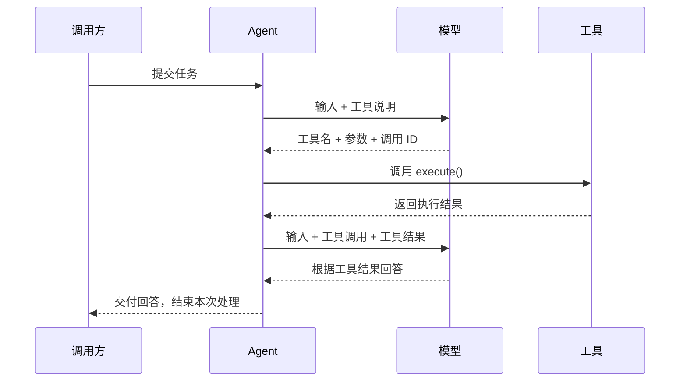

上一章的 Agent 可以利用历史继续回答，但遇到需要获取外部信息或执行操作的问题时，还无法调用程序完成任务。本章增加工具调用能力：模型提出调用请求，Agent 执行对应工具，把结果交回模型继续处理。调用方仍然只提交一次 `prompt()`。



模型决定请求哪个工具、传入什么参数；Agent 负责找到工具、执行并组织结果消息；工具负责完成具体操作。下面用 pi 原生 `read` 读取文件作为例子，沿着这条通用调用链追踪一次任务。模型请求继续使用前文的百炼配置和 `models.streamSimple()`。

## 1. 一次工具调用涉及哪些数据

先区分四个对象，避免把“模型提出请求”和“程序已经执行”混为一谈：

| 对象 | 由谁提供 | 在调用过程中的作用 |
|---|---|---|
| 工具定义 `AgentTool` | 应用注册到 Agent 的工具对象 | 工具名、用途、参数格式，以及本地 `execute()` 函数 |
| 调用请求 `ToolCall` | 模型回复 | 指定工具名、参数和本次调用的 ID |
| 函数返回值 `AgentToolResult` | `execute()` | 给模型读取的 `content` 和给程序使用的 `details` |
| 结果消息 `ToolResultMessage` | Agent | 给返回值补上调用 ID、工具名和成功或失败标记，加入对话 |

工具定义中的 `name`、`description`、`parameters` 继承自 pi-ai 的 `Tool`。`AgentTool` 在这份说明上增加本地执行能力。下面摘录工具接入所需的定义，省略可选字段和执行回调的可选参数：

```ts
// pi-ai：模型需要的工具说明
export interface Tool<TParameters extends TSchema = TSchema> {
	name: string;
	description: string;
	parameters: TParameters;
	// ...
}

// pi-agent-core：在工具说明上增加本地执行函数
export interface AgentTool<TParameters extends TSchema = TSchema, TDetails = any> extends Tool<TParameters> {
	label: string;
	// ...
	execute: (
		toolCallId: string,
		params: Static<TParameters>,
		// ...
	) => Promise<AgentToolResult<TDetails>>;
}
```

`parameters` 是参数的结构描述，`Static<TParameters>` 是从中得到的 TypeScript 参数类型。`label` 是用于界面显示的名称；模型根据 `name` 和 `description` 判断怎样使用工具。

`execute()` 的返回值包含两个必需字段：

```ts
export interface AgentToolResult<T> {
	content: (TextContent | ImageContent)[];
	details: T;
	// ...
}
```

工具将需要交给模型的信息放进 `content`，供程序或界面使用的结构化信息放进 `details`；没有附加信息时，`details` 可以为 `undefined`。这个返回值还不是一条消息，调用 ID 等关联信息由 Agent 补齐。

## 2. 把工具注册到 Agent：以 read 为例

沿用第七章的 `models`、`model` 和消息保存方式，接入工具的入口是 `initialState.tools`：把符合 `AgentTool` 契约的对象放入这个数组，Agent 就能将它的说明交给模型，并执行模型对它的调用请求。

示例使用 `@earendil-works/pi-agent-core` 提供的原生 `read` 工具。Lab 通过 `createReadTool()` 创建工具并绑定本地执行环境，得到可注册的 `read` 对象。任务是读出文件中的验证代号，模型需要先调用工具取得文件内容，再回答用户。

假设当前目录下已有 `note.txt`，内容为 `本次验证代号：read-643219`，接入只需增加工具配置：

```ts
import { Agent } from "@earendil-works/pi-agent-core";

// read 是 Lab 中已创建并绑定本地执行环境的原生工具。
const agent = new Agent({
	initialState: {
		model,
		systemPrompt: "严格按用户要求回答。读取文件必须调用 read，取得结果后只回复文件中的验证代号，不要重复读取。",
		messages: [],
		tools: [read],
	},
	streamFn: (model, context, options) =>
		models.streamSimple(model, context, { ...options, maxTokens: 256 }),
});

// 完整 Lab 通过 subscribe() 记录工具执行和消息结束事件。
await agent.prompt("请用 read 读取 note.txt，只回复其中的验证代号。");
```

Lab 会自行准备临时目录和文件，工具读取的 `note.txt` 就位于该目录。原生工具的创建入口可见 [`read.ts`](https://github.com/earendil-works/pi/blob/3fc3ef532b966b28b764af070d62302c0acab0d5/packages/agent/src/harness/tools/read.ts#L45-L55)。

注册完成后，调用方只执行 `agent.prompt()`。工具的选择来自模型回复，工具的执行和后续模型请求都由 Agent 推进。

## 3. 从工具说明到执行结果，再回到模型

前文的输入整理、历史合并和模型调用入口保持原样。工具调用发生在 `runLoop()` 内部，主路径是：

```text
runLoop()
├─ streamAssistantResponse() → 第一次请求模型，得到包含工具调用的消息
├─ executeToolCalls() → 调度工具执行
│  ├─ prepareToolCall() → 找到工具，校验参数
│  ├─ executePreparedToolCall() → 调用本地 execute()
│  └─ createToolResultMessage() / emitToolResultMessage() → 形成并保存结果消息
└─ streamAssistantResponse() → 带上调用和结果，再次请求模型
```

取得工具结果并追加到消息列表后，Agent 再发送下一次模型请求。

### 工具怎样进入模型请求

第七章介绍过 `createContextSnapshot()` 会复制历史数组。它同时复制工具数组：

```ts
private createContextSnapshot(): AgentContext {
	return {
		systemPrompt: this._state.systemPrompt,
		messages: this._state.messages.slice(),
		tools: this._state.tools.slice(),
	};
}
```

`runAgentLoop()` 保留这些上下文字段，并把历史和新输入合成当前消息列表。随后 `streamAssistantResponse()` 把工具和消息一起交给模型调用函数：

```ts
const llmContext: Context = {
	systemPrompt: context.systemPrompt,
	messages: llmMessages,
	tools: context.tools,
};
// ...
const response = await streamFunction(config.model, llmContext, {
	...config,
	apiKey: resolvedApiKey,
	signal,
});
```

这里的 `tools` 在本地仍是包含 `execute()` 的对象。百炼使用的 OpenAI 兼容适配器通过 `convertTools()` 提取工具名、描述和参数结构，构造请求中的函数说明。**发送给模型的是说明，JavaScript 执行函数留在本地。**

### 模型返回的是调用请求

第一次模型消息的 `content` 不再只有文本，还可以包含下面这种内容块。这是 `ToolCall` 的核心定义：

```ts
export interface ToolCall {
	type: "toolCall";
	id: string;
	name: string;
	arguments: Record<string, any>;
	// ...
}
```

例如，模型要求读取文件时，完整消息中会包含这样的数据；调用 ID 仅作示意：

```ts
{
	type: "toolCall",
	id: "call_1",
	name: "read",
	arguments: { path: "note.txt" },
}
```

这块内容仍属于一条 `role: "assistant"` 的消息。`streamAssistantResponse()` 等待完整回复、写回当前消息列表并发出 `message_end`，然后才把消息返回 `runLoop()`。因此，工具调用消息与第七章的文本回复一样，也会进入 Agent 历史。

`runLoop()` 检查完整消息中的工具请求：

```ts
const toolCalls = message.content.filter((c) => c.type === "toolCall");
```

正常工具回复常以 `stopReason: "toolUse"` 结束，但循环识别工具请求的依据是这些内容块。此时只是模型提出了请求，本地函数尚未执行。

### Agent 按名称找到函数，用校验后的参数调用它

`executeToolCalls()` 把当前上下文和模型消息交给调度函数。每个调用进入 `prepareToolCall()`，先查找同名工具，再准备参数：

```ts
const tool = currentContext.tools?.find((t) => t.name === toolCall.name);
// ...
const preparedToolCall = prepareToolCallArguments(tool, toolCall);
const validatedArgs = validateToolArguments(tool, preparedToolCall);
// ...
return {
	kind: "prepared",
	toolCall,
	tool,
	args: validatedArgs,
};
```

`validateToolArguments()` 使用工具的参数结构校验输入。准备结果同时保存找到的工具、原调用请求和校验后的参数，供执行函数使用。

准备成功后，`executePreparedToolCall()` 调用工具的 `execute()`。下面用伪代码保留实际的调用名称和主要参数：

```ts
const result = await prepared.tool.execute(
	prepared.toolCall.id,
	prepared.args,
	// ...
);
// ...
return { result, isError: false };
```

调度过程使用同一组字段：按 `name` 查找已注册工具，将调用 ID 和校验后的参数交给该工具的 `execute()`，等待返回值。示例中找到的是 `read`，参数为 `{ path: "note.txt" }`。具体怎样读取文件由工具实现负责。

这次执行得到的返回值如下。它展示的是工具执行后的数据，符合前面介绍的 `AgentToolResult`：

```ts
{
	content: [{ type: "text", text: "本次验证代号：read-643219" }],
	details: undefined,
}
```

Agent 接下来处理这个返回值，为它关联原调用并构造消息。

### 返回值怎样变成一条可关联的结果消息

工具返回后，调度函数取得最终结果，并调用 `createToolResultMessage()`。下面保留本例使用的字段：

```ts
return {
	role: "toolResult",
	toolCallId: finalized.toolCall.id,
	toolName: finalized.toolCall.name,
	content: finalized.result.content ?? [],
	details: finalized.result.details,
	// ...
	isError: finalized.isError,
	timestamp: Date.now(),
};
```

`toolCallId` 复制自模型请求的 `id`，所以结果能准确对应到那一次调用。工具名说明执行了什么，调用 ID 说明这是哪一次执行的结果。

接着，`emitToolResultMessage()` 发出消息事件：

```ts
await emit({ type: "message_start", message: toolResultMessage });
await emit({ type: "message_end", message: toolResultMessage });
```

第七章已经说明，`Agent.processEvents()` 在 `message_end` 分支执行 `this._state.messages.push(event.message)`。这个分支并不限于用户或助手消息，因此工具结果也会保存。此时 Agent 历史依次是：

```text
user        请用 read 读取 note.txt。
assistant   toolCall: read({ path: "note.txt" }), id = call_1
toolResult  本次验证代号：read-643219, toolCallId = call_1
```

历史保存完成后，调度函数把结果消息集合返回给 `runLoop()`。循环还要把它们加入本轮执行上下文，供紧接着的模型请求使用。

### 工具执行完成，为什么还会再请求一次模型

工具执行完成后，`runLoop()` 先把结果消息追加到本轮上下文，供模型读取：

```ts
toolResults.push(...executedToolBatch.messages);
// ...

for (const result of toolResults) {
	currentContext.messages.push(result);
	newMessages.push(result);
}
```

`executedToolBatch.messages` 包含刚刚生成的工具结果消息。追加完成后，循环再次调用 `streamAssistantResponse()`，把这些结果连同已有消息交给模型。

下面用伪代码串起工具正常执行时的循环，保留真实函数名和调用顺序：

```ts
let hasMoreToolCalls = true;
while (hasMoreToolCalls) {
	const message = await streamAssistantResponse(...);
	const toolCalls = message.content.filter((c) => c.type === "toolCall");
	hasMoreToolCalls = false;
	if (toolCalls.length > 0) {
		const executedToolBatch = await executeToolCalls(...);
		// 将结果消息追加到 currentContext.messages 和 newMessages
		hasMoreToolCalls = true; // 带上工具结果，再请求一次模型
	}
}
```

第二次 `streamAssistantResponse()` 读取的上下文已经包含问题、调用请求和工具结果。百炼适配器将 `toolResult` 转成协议中的 `role: "tool"` 消息，携带文本内容和 `tool_call_id`。在本例中，模型根据工具结果生成最终文本，没有再请求工具，循环条件保持为 `false`，本次处理结束。如果新回复仍包含工具调用，Agent 就按同样的步骤继续执行，再将结果交回模型。

一次 `prompt()` 中的消息变化因此是：

| 时刻 | 本轮消息列表 | 接下来的动作 |
|---|---|---|
| 第一次请求前 | `[用户问题]` | 模型决定调用工具 |
| 第一次模型回复完成 | `[用户问题, 工具调用消息]` | Agent 执行对应工具 |
| 工具结果追加后 | `[用户问题, 工具调用消息, 工具结果]` | 再次请求模型 |
| 最终回复完成 | `[用户问题, 工具调用消息, 工具结果, 文本回答]` | 结束 `prompt()` |

“本轮消息列表”仍是第七章介绍的执行用数组；Agent 历史通过每条消息的结束事件独立增长。这里没有新增用户输入，两次模型请求都属于同一次 `prompt()`。

因此，一条助手消息的 `message_end` 不代表整个任务结束。读取最终答案应等到 `await agent.prompt()` 完成，再检查最后一条助手消息。

## 4. 运行 Lab，检查工具是否真的参与了回答

完整程序在 `labs/08-tool-calling.ts`。它用原生 `read` 验证同一条通用路径：注册工具、接收调用、执行并保存结果，再发起模型请求。百炼配置和请求记录沿用第七章，输出关注工具参数、执行结果和最终回答。

沿用前文的 `.env` 和两个直接依赖 `@earendil-works/pi-ai`、`@earendil-works/pi-agent-core`，在项目根目录安装并运行：

```bash
npm install
node labs/08-tool-calling.ts
```

Lab 在临时目录创建 `note.txt`，写入随机生成的验证代号，并将原生工具的工作目录设为该目录。请求中只给出文件名，模型必须读取文件才能得到代号；结束后 Lab 清理临时目录。下面是一次真实调用的输出，后续运行的代号会变化：

```text
model: qwen3.8-flash
input: 请用 read 读取 note.txt，只回复其中的验证代号。
request 1 roles: user
assistant stopReason: toolUse
tool_execution_start: read
read args: {"path":"note.txt"}
tool_execution_end: read
read result: 本次验证代号：read-643219
request 2 roles: user -> assistant -> toolResult
assistant stopReason: stop
final answer: read-643219
history roles: user -> assistant -> toolResult -> assistant
chapter 8 native read tool passed
```

`tool_execution_start` 和 `tool_execution_end` 是 Agent 通知工具执行过程的事件。这里用它们显示过程；工具结果进入历史，仍依靠后面的 `message_end`。

程序检查四组事实：

1. 一次 `prompt()` 恰好发出两次模型请求，两次都携带工具说明；第二次请求包含完整的调用消息和结果消息。
2. 只出现一次 `read` 执行的开始与结束事件，模型请求的文件是 `note.txt`；结果消息的 `toolCallId` 与调用 ID 相同，`isError` 为 `false`，返回文本与写入文件的内容完全一致。
3. 先保存工具调用消息，再执行工具、保存工具结果，最后保存回答；历史恰好包含四条消息。
4. 最终回复正常结束、没有继续请求工具，文字等于工具读出的验证代号。

这些断言同时验证工具确实执行、结果进入后续请求，以及模型依据结果完成回答。两次模型请求是这个示例的预期过程。

## 5. 本章小结

现在，Agent 能从一次输入继续推进工具执行：向模型提供已注册工具的说明，按回复中的名称找到工具，用校验后的参数调用 `execute()`，将返回值关联到原调用并追加为结果消息，再请求模型继续处理。

`read` 示例验证了这个过程。换成其他符合 `AgentTool` 契约的工具时，Agent 仍通过相同的字段和调用入口调度；变化的是工具执行的具体操作。一条最终回复不再请求工具时，本例中的 `prompt()` 才完成，历史保留整个处理过程。

源码核对入口：[`types.ts` 中的工具与返回值](https://github.com/earendil-works/pi/blob/3fc3ef532b966b28b764af070d62302c0acab0d5/packages/agent/src/types.ts#L361-L419)、[`pi-ai 的调用与结果消息`](https://github.com/earendil-works/pi/blob/3fc3ef532b966b28b764af070d62302c0acab0d5/packages/ai/src/types.ts#L371-L470)、[`agent.ts` 中的上下文快照与事件保存](https://github.com/earendil-works/pi/blob/3fc3ef532b966b28b764af070d62302c0acab0d5/packages/agent/src/agent.ts#L437-L558)、[`agent-loop.ts` 中的循环和工具执行](https://github.com/earendil-works/pi/blob/3fc3ef532b966b28b764af070d62302c0acab0d5/packages/agent/src/agent-loop.ts#L156-L273)、[`openai-completions.ts` 中的消息与工具转换](https://github.com/earendil-works/pi/blob/3fc3ef532b966b28b764af070d62302c0acab0d5/packages/ai/src/api/openai-completions.ts#L1367-L1498)。
