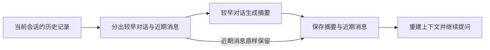

> 上一章：[保存并恢复会话](../10-session-persistence/) · 系列导读：[从一次模型调用到 Agent 内核](../00-overview/)

上一章已经能保存并恢复会话，但随着对话持续，历史消息也会越来越长，逐渐占满模型能够接收的上下文。本章沿着 pi 的实现，说明怎样把较早的对话整理成摘要、保留近期消息，再用缩短后的上下文继续任务。



下面是全文引用函数的调用关系示意，省略参数与错误处理，不能直接运行：

```text
// 第 2 节：判断与划分
contextTokens = estimateContextTokens(messages).tokens
if shouldCompact(contextTokens, ...):
    preparation = prepareCompaction(entries, ...)
        └─ findCutPoint(...)

    // 第 3 节：生成摘要
    result = compact(preparation, ...)
        └─ generateSummaryWithUsage(...)
            ├─ convertToLlm(...) → serializeConversation(...)
            └─ completeSimpleWithRetries(...)
                └─ models.completeSimple(...)

    // 第 4 节：保存并重建
    session.appendEntry(压缩记录, ...)
    entries = session.findEntriesOnBranch(...)
    messages = buildSessionContext(entries).messages
        └─ sessionEntryToContextMessages(...)
            └─ createCompactionSummaryMessage(...)

// 第 4 节：Agent 使用重建的历史继续任务
agent.prompt(新输入)
    └─ convertToLlm(...) → 模型请求
```

## 1. 会话已经能恢复，为什么还要缩短它？

每完成一轮任务，历史中就会增加用户输入、模型回复，以及可能发生的工具调用和工具结果。这些消息帮助模型理解已经发生的事情，但其中既有继续任务所需的决定与结果，也有已经处理完的大段中间内容。

模型一次请求能够接收的内容有容量限制，通常用 **token** 衡量。Token 是模型处理文本等内容时使用的计量单位，随着对话增长，历史会占用越来越多的容量，留给新输入和回复的空间也越来越少。

第十章解决了“消息能否保存下来”，这里需要进一步决定“下一次请求应该带哪些内容”。磁盘可以保留完整记录，模型则使用适合继续任务的一部分内容。

直接丢掉旧消息，可能同时丢掉用户最初的目标、必须遵守的约束和已经确认的结果。因此 pi 使用**上下文压缩**：让模型将较早的对话整理为摘要，再与近期消息一起组成后续上下文。

为什么还要原样保留近期消息？最近几轮往往包含正在处理的问题和操作细节，直接保留可以避免过早把这些细节概括掉。压缩后的上下文因此由两部分组成：

```text
压缩前：较早的完整对话 → 近期完整消息
压缩后：较早对话的摘要 → 近期完整消息
```

这里缩短的是后续请求使用的上下文，磁盘中的原始记录仍然保留。摘要由模型生成，可能遗漏细节，不能用于无损还原原文；它的目标是保留继续任务所需的信息。

## 2. 什么时候压缩，怎样划分历史？

确定采用“摘要加近期消息”的方式后，还需要作出两个决定：什么时候开始压缩，以及从哪里划分较早对话和近期消息。pi 分别通过用量阈值和近期消息预算回答这两个问题。

### 怎样判断历史已经接近容量限制？

如果等到历史填满容量才处理，生成摘要的请求本身也可能放不下。pi 的 [`shouldCompact()`](https://github.com/earendil-works/pi/blob/3fc3ef532b966b28b764af070d62302c0acab0d5/packages/agent/src/harness/compaction/compaction.ts) 提前留出空间。函数体的真实源码是：

```ts
if (!settings.enabled) return false;
return contextTokens > contextWindow - settings.reserveTokens;
```

`contextTokens` 是当前上下文的 token 用量，`contextWindow` 是模型容量，`reserveTokens` 是预留预算。例如，容量为 32,000、预留 4,000 时，用量超过 28,000 就满足这一判断。

其中，用量由 `estimateContextTokens()` 优先依据最近一次有效模型回复里的 `usage` 计算，并估算其后新增消息；没有可用用量时，则按消息内容估算。这是触发判断所需的近似值，不是对任意请求都精确的 token 计数。

这个判断确定了开始压缩的时机，但尚未决定哪些内容要被替换成摘要。下一步需要在历史中找到保留近期消息的分界。

### 决定压缩后，怎样划分历史？

要找到这个分界，可以从最新消息开始向前保留，直到达到希望留下的内容量。pi 的 `prepareCompaction()` 接收按由旧到新排列的会话记录，根据 `settings.keepRecentTokens` 指定的近期消息预算，调用 `findCutPoint()` 寻找分界。这里的预算决定保留多少近期内容，前面的 `reserveTokens` 则用于判断何时开始压缩。下面是[实际选择分界的源码](https://github.com/earendil-works/pi/blob/3fc3ef532b966b28b764af070d62302c0acab0d5/packages/agent/src/harness/compaction/compaction.ts)：

```ts
const cutPoint = findCutPoint(compactableEntries, 0, boundaryEnd, settings.keepRecentTokens);
```

其中，`compactableEntries` 是这次参与划分的记录，`boundaryEnd` 是它们的结束位置；返回结果中的 `cutPoint.firstKeptEntryIndex` 指向第一条需要保留的记录。下面沿分界落在一轮用户消息起点的情况展开：它之前的完整轮次用于生成摘要，从它开始的近期消息原样保留。

[`findCutPoint()`](https://github.com/earendil-works/pi/blob/3fc3ef532b966b28b764af070d62302c0acab0d5/packages/agent/src/harness/compaction/compaction.ts) 从历史末尾向前累计消息的估算量，再选取可用的消息边界。它按消息整体保留，不会把一条文本截成一半；工具结果也不能单独成为保留区的起点，以免与前面的工具调用脱节。因此，保留预算不是严格的长度上限。

分界确定后，`prepareCompaction()` 收集两侧的消息，形成后续处理需要的数据：

| 字段 | 包含什么 | 下一步怎样使用 |
|---|---|---|
| `messagesToSummarize` | 分界之前需要概括的较早对话 | 交给模型生成摘要 |
| `retainedTail` | 从保留位置开始的近期完整消息 | 原样保留，放在摘要之后 |
| `tokensBefore` | 压缩前的上下文估算量 | 随压缩结果记录下来 |

此时，历史已经分成待概括的 `messagesToSummarize` 和原样保留的 `retainedTail`。数据划分完成了，接下来才需要请求模型，把前一部分变成摘要。

## 3. 旧消息怎样变成可以继续任务的摘要？

`compact()` 接收上一节的准备结果，使用前文介绍的模型调用能力概括 `messagesToSummarize`。这次请求需要同时告诉模型两件事：要整理哪段对话，以及继续任务时需要保留哪些信息。

### 生成摘要时，模型收到的是什么？

接着，`compact()` 调用 `generateSummaryWithUsage()` 生成旧对话摘要。后者先将旧消息转成模型消息，再通过 `serializeConversation()` 整理成带角色标记的文本。下面是该函数中的连续源码摘录：

```ts
const llmMessages = convertToLlm(currentMessages);
const conversationText = serializeConversation(llmMessages);
let promptText = `<conversation>\n${conversationText}\n</conversation>\n\n`;
if (previousSummary) {
	promptText += `<previous-summary>\n${previousSummary}\n</previous-summary>\n\n`;
}
promptText += basePrompt;
```

这段代码先用 `serializeConversation()` 整理对话，以 `[User]`、`[Assistant]`、`[Assistant tool calls]` 和 `[Tool result]` 等标记区分发言与操作结果，再将文本放进 `<conversation>` 标签。工具调用在这里成为待整理的文字，不会重新执行。

首次压缩时没有 `previousSummary`，材料就是这段旧对话。**如果同一会话已经压缩过**，还需要保留上次总结的信息，因此代码会附上已有摘要，让模型结合新进展更新它。两种情况最终都会追加 `basePrompt`，说明摘要需要保留什么。对应实现见 [`generateSummaryWithUsage()`](https://github.com/earendil-works/pi/blob/3fc3ef532b966b28b764af070d62302c0acab0d5/packages/agent/src/harness/compaction/compaction.ts)。

为了保留继续任务所需的信息，pi 的摘要提示词要求按以下结构整理内容：

| 摘要部分 | 为继续任务保留什么 |
|---|---|
| Goal | 用户希望完成的目标 |
| Constraints & Preferences | 必须遵守的约束和偏好 |
| Progress | 已完成、正在进行和受阻的工作 |
| Key Decisions | 已作出的关键决定及原因 |
| Next Steps | 接下来应该做什么 |
| Critical Context | 继续工作所需的数据、引用和其他关键信息 |

这样的摘要保留的是任务状态，而不只是把每轮对话缩写一遍。系统提示词还要求模型只输出结构化总结，不继续回答材料里的问题。

整理好的文本被放入 `summarizationMessages`，作为一条用户消息发给模型。`generateSummaryWithUsage()` 的实际调用如下：

```ts
const response = await completeSimpleWithRetries(
	models,
	model,
	{ systemPrompt: SUMMARIZATION_SYSTEM_PROMPT, messages: summarizationMessages },
	completionOptions,
	retry,
	callbacks,
);
```

这里的 `completeSimpleWithRetries()` 调用前文使用过的 `models.completeSimple()`，取得完整回复。摘要是一次独立的模型请求：输入是待整理的历史与摘要要求，输出是用于后续对话的摘要文本。

### 怎样把摘要与保留的消息合在一起？

模型只负责生成较早对话的摘要；上一节留下的 `retainedTail` 仍然保留原来的消息内容。生成成功后，pi 从回复中取出文本，`compact()` 将这两部分一起返回，作为后续重建上下文的依据：

```text
result.value
  summary       → 旧对话的摘要文本
  retainedTail  → 原样保留的近期完整消息
  tokensBefore  → 压缩前的上下文估算量
```

`compact()` 返回数据，本身不写会话文件，也不替换 Agent 内存中的历史。摘要请求报错或被中止时，pi 返回错误结果；调用方应在成功后才保存压缩结果并重建上下文，避免用失败结果替换原有历史。

## 4. 摘要怎样进入下一次模型请求？

现在已经有了摘要和需要保留的消息，但会话中原先的完整历史还在。要让压缩结果在后续请求以及重启后都生效，需要先把结果记录到会话里，再据此选出下一次请求使用的消息。

### 怎样把压缩结果保存到会话中？

第十章的会话文件已经能够追加消息，这里追加的是一条 `type: "compaction"` 的压缩记录。[`CompactionEntry`](https://github.com/earendil-works/pi/blob/3fc3ef532b966b28b764af070d62302c0acab0d5/packages/agent/src/harness/session/types.ts) 中支撑上下文重建的字段如下，摘录省略了可选的统计和附加信息字段：

```ts
export interface CompactionEntry extends EntryBase {
	type: "compaction";
	summary: string;
	retainedTail: AgentMessage[];
	tokensBefore: number;
}
```

它把摘要 `summary` 与近期完整消息 `retainedTail` 存在同一条记录里。结果经 [`Session.appendEntry()`](https://github.com/earendil-works/pi/blob/3fc3ef532b966b28b764af070d62302c0acab0d5/packages/agent/src/harness/session/session.ts) 提交后，沿用前章的记录写入流程：补齐顺序、父记录和时间，再追加到 JSONL 文件。这个过程增加了一条压缩记录，原来的消息记录仍然存在。

这样，保存的是一次“后续应该使用什么上下文”的结果，原始对话也仍然可以从磁盘记录中查到。

### 怎样从记录中重建更短的上下文？

保存后，会话中同时存在原始消息和压缩记录。如果仍把所有记录逐条转换成消息，原始对话和摘要就会一起进入请求，压缩也就失去了作用。因此，第十章使用的 `buildSessionContext()` 在重建上下文时，默认先找到当前路径上最新的一条压缩记录，选择它和它之后的记录；更早的记录不会再次加入模型上下文。支撑这一选择的[源码返回语句](https://github.com/earendil-works/pi/blob/3fc3ef532b966b28b764af070d62302c0acab0d5/packages/agent/src/harness/session/context.ts)是：

```ts
return compaction === undefined ? [...pathEntries] : [compaction, ...pathEntries.slice(compactionIndex + 1)];
```

随后，同一文件里的 `sessionEntryToContextMessages()` 把压缩记录展开为摘要消息和近期消息。对应真实源码为：

```ts
if (entry.type === "compaction") {
	return [
		createCompactionSummaryMessage(entry.summary, entry.tokensBefore, entry.timestamp),
		...entry.retainedTail,
	];
}
```

`createCompactionSummaryMessage()` 返回的消息角色是 `compactionSummary`。所以，此时的历史排列为：

```text
摘要消息 → 压缩时保留的近期消息 → 压缩后新产生的消息
```

前两部分来自压缩记录，最后一部分来自它之后的普通消息记录。重启后使用同样的恢复函数，也能从磁盘得到这份较短的上下文。现在，Agent 已经知道后续要使用哪些消息；接下来要看，这些消息中的摘要怎样出现在发给模型的请求里。

### 模型最终收到的摘要是什么样的？

刚才重建的历史里，摘要是一条 `role: "compactionSummary"` 的消息，正文保存在它的 `summary` 字段中。这是 pi 内部表示摘要的方式，尚不是模型请求中的消息格式。

模型需要实际读到摘要文本，却不认识 pi 定义的 `compactionSummary` 角色。因此，在组装下一次请求时，需要把这条内部消息转换为模型能够接收的消息，并说明这段文字来自此前的对话。

pi 提供的 `convertToLlm()` 完成这一步：取出 `summary` 文本，加上“此前对话已压缩为以下摘要”的说明，再包装成一条 `user` 消息。其[摘要转换分支](https://github.com/earendil-works/pi/blob/3fc3ef532b966b28b764af070d62302c0acab0d5/packages/agent/src/harness/messages.ts)为：

```ts
case "compactionSummary":
	return {
		role: "user",
		content: [
			{ type: "text" as const, text: COMPACTION_SUMMARY_PREFIX + m.summary + COMPACTION_SUMMARY_SUFFIX },
		],
		timestamp: m.timestamp,
	};
```

Agent 在请求模型之前[实际调用这项转换](https://github.com/earendil-works/pi/blob/3fc3ef532b966b28b764af070d62302c0acab0d5/packages/agent/src/agent-loop.ts#L292-L299)，再将结果放入请求的 `messages`。至此，较早的完整对话被摘要替代，近期消息和新输入接在后面，模型便能基于这份更短的上下文继续任务。

## 5. 运行 Lab，观察压缩后能否继续任务

完整程序在 `labs/11-context-compaction.ts`。实验沿用前章的文件读取和会话保存流程，主动执行一次压缩，观察上下文是否变短、关键信息是否仍可用于回答。

核心流程是：

1. 读取包含随机代号和重复内容的 `note.txt`，保存对话，再完成一轮不重复代号的简短问答。
2. 将较早的读取对话生成摘要，原样保留最近一问一答，把压缩结果追加到会话文件。
3. 重新打开会话，将重建的消息经 `convertToLlm` 转换后交给模型，追问原来的代号。此时源文件已删除，新 Agent 没有读取工具。

沿用前文依赖和根目录 `.env` 中的 `DASHSCOPE_API_KEY`，在能够访问百炼的本地环境中运行；按项目约定在沙箱外执行：

```bash
node labs/11-context-compaction.ts
```

一次运行的输出节选如下，代号和字符数会随回复变化：

```text
original code: read-550415
summarize messages: 4
retained roles: user -> assistant
stored entries: 6 -> 7
after roles: compactionSummary -> user -> assistant
context JSON characters: 11279 -> 1274
source file exists: false
answer: read-550415
```

检查三个结果：重建后的历史变成“摘要加近期消息”；消息 JSON 字符数减少；最终回答与最初代号一致。实验设置及转换注意点见 TS 中对应位置的注释。

## 6. 本章小结

Agent 现在可以从已保存的会话中选出较早的对话，让模型整理成摘要，同时保留近期完整消息。摘要和近期消息作为一条压缩记录追加到磁盘，恢复时据此重建更短的上下文，再将摘要转换成模型能够接收的消息。

这样，旧对话不必在每次请求中完整重发，后续任务仍可使用摘要里保留下来的目标、约束和关键结果。会话文件保留完整记录，模型请求则使用“摘要、近期消息和新增消息”组成的上下文，为后续对话腾出空间。

源码核对入口：[`compaction.ts` 中的用量判断、历史划分和摘要生成](https://github.com/earendil-works/pi/blob/3fc3ef532b966b28b764af070d62302c0acab0d5/packages/agent/src/harness/compaction/compaction.ts)、[`utils.ts` 中的对话序列化](https://github.com/earendil-works/pi/blob/3fc3ef532b966b28b764af070d62302c0acab0d5/packages/agent/src/harness/compaction/utils.ts)、[`types.ts` 中的压缩记录](https://github.com/earendil-works/pi/blob/3fc3ef532b966b28b764af070d62302c0acab0d5/packages/agent/src/harness/session/types.ts)、[`session.ts` 中的记录追加](https://github.com/earendil-works/pi/blob/3fc3ef532b966b28b764af070d62302c0acab0d5/packages/agent/src/harness/session/session.ts)、[`context.ts` 中的上下文重建](https://github.com/earendil-works/pi/blob/3fc3ef532b966b28b764af070d62302c0acab0d5/packages/agent/src/harness/session/context.ts)、[`messages.ts` 中的摘要消息转换](https://github.com/earendil-works/pi/blob/3fc3ef532b966b28b764af070d62302c0acab0d5/packages/agent/src/harness/messages.ts)、[`agent-loop.ts` 中的请求前转换调用](https://github.com/earendil-works/pi/blob/3fc3ef532b966b28b764af070d62302c0acab0d5/packages/agent/src/agent-loop.ts#L292-L299)。
